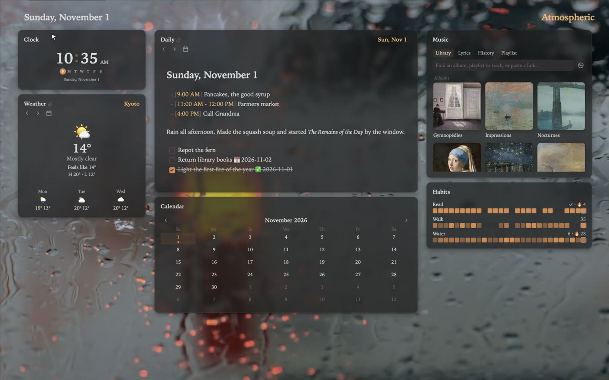

Title: Tiles and columns

# Tiles and columns | Arrange the room.

Atrium lays your cards out one of two ways. Tiles fill the window edge to edge, like a mosaic; columns line up like a desk, with a main column in the middle. Same cards either way: change one and the other knows.

## Two views | Tiles or columns. *Same cards, either way.*

<video src="/_assets/guide/tiles-views.mp4" poster="/_assets/guide/tiles-views.jpg"></video>

Right-click the page's heading and pick **Tiles** or **Columns**, or run **Show modules in tiles** or **Show modules in columns** from the command palette. A card added, removed or changed in one view is the same in the other.

## Resize | Drag the walls. *Everything else moves over.*

<video src="/_assets/guide/tiles-resize.mp4" poster="/_assets/guide/tiles-resize.jpg"></video>

- Drag the line between two tiles to trade space between them.
- Double-click the line, or right-click it and choose **Equal sizes**, to even them out.
- **Equal sizes for all cards**, on the page's right-click menu or <kbd>⇧B</kbd>, evens out the whole page.

## Corners | Corners go *both ways.*

<video src="/_assets/guide/tiles-corner.mp4" poster="/_assets/guide/tiles-corner.jpg"></video>

Point at a card's corner and it lights up. Drag it to move both lines that meet there at once. In columns, a corner sets the card's height and its column's width; on an expanded card, its width and height.

## Cards fit their size | Small cards *keep it short.*

<video src="/_assets/guide/tiles-fit.mp4" poster="/_assets/guide/tiles-fit.jpg"></video>

Cards with a reading lay themselves out by their own size as you resize them. Tiny, they show just the reading: the time, the weather now, the track playing, the timer or the next event. Medium adds the day's details and the days ahead; large adds the hours.

## Adding | Room for *one more.*

<video src="/_assets/guide/tiles-add.mp4" poster="/_assets/guide/tiles-add.jpg"></video>

Point at a line between tiles and a dotted line shows where a card would go. Click, pick a module, and the tiles make room.

Near the middle of a whole stack of tiles, the new card goes beside the stack; near one card, beside just that card. The page's own edges, just outside the tiles, work the same way.

## Moving | Pick a card up. *Put it down somewhere better.*

<video src="/_assets/guide/tiles-move.mp4" poster="/_assets/guide/tiles-move.jpg"></video>

- **Drag** a card by its frame. While you drag, the others close up, as they'll be once it's gone. Drop it on a tile to take the half nearest the pointer, or on a line or the page's edge to go beside the tiles along it.
- **Or use the keys**: click a card's frame, then <kbd>⇧</kbd> with an arrow moves it past the tile beside it.
- **Join** puts two neighbours in one place, the other way round: side by side becomes stacked, and stacked becomes side by side. It's on a card's right-click menu, or <kbd>⇧J</kbd> then an arrow.

## Columns | A desk, *if you prefer.*

Columns keep a main column with side columns around it. Click a dotted line between cards to add a module there, drag a card's frame to move it, and drag a column's edge to resize it.

**Fit to screen width** stretches and shrinks the columns with the window, keeping their proportions, and wraps them onto rows when it's too narrow.
