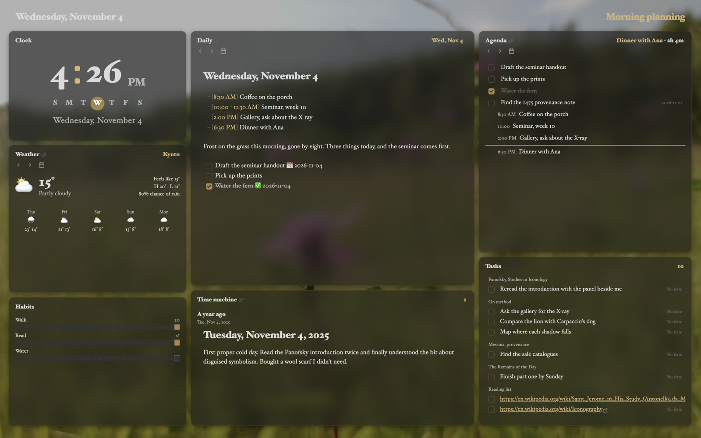
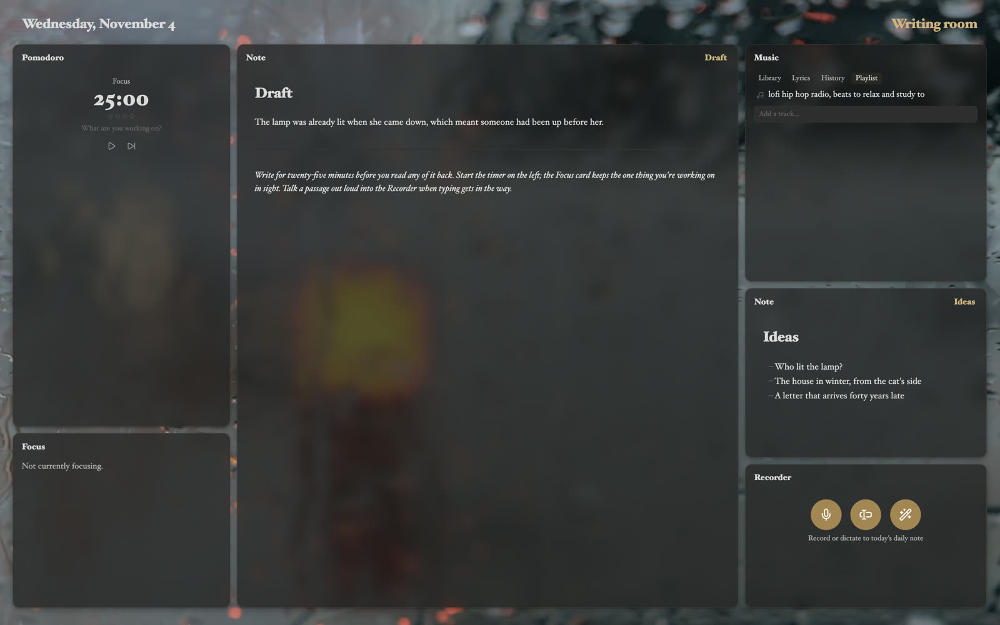
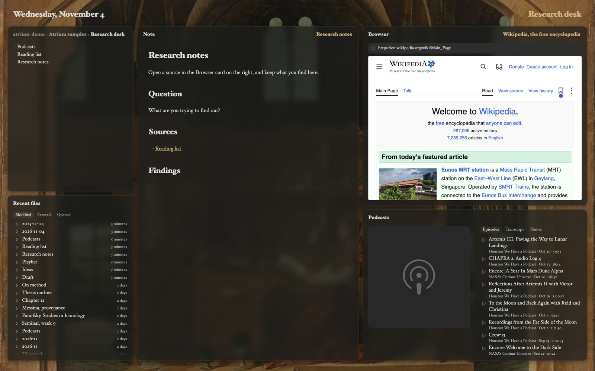

Title: Sample workspaces

# Sample workspaces | Move into a room *ready-made.*

Three workspaces to start from, each set up for one part of the day. Each is added beside your own workspaces, under its own name, and nothing you have is changed.

There are two ways to add one:

- **Open in Obsidian** adds it in one step, to the vault you have open. It needs Atrium 0.7 or later; on an older version Obsidian says *Unrecognized URI action*. Update Atrium with *Settings → Community plugins → Check for updates*, or download the file instead. Adding one takes a few seconds, so click once and wait for the notice.
- **Download the file** saves it to your computer. In Obsidian, choose **Import workspace…** from the workspace menu and pick the file. This works on any vault you choose.

Each one uses cards from [Atrium Complete](/atrium-complete). Start the free 30-day trial, in Atrium's settings, to see them all at work.

## Morning planning | The day, *before it starts.*

Today's daily note in the middle, with what's on the agenda and what's due beside it. The clock and the weather on the left, three habits to tick off under them, and the Time machine shows what you wrote a year ago today. Over a meadow at first light, on video.

The daily note, agenda and tasks are your own: they show what's already in your vault.

<a class="btn" href="obsidian://atrium-workspace?url=https%3A%2F%2Fatrium-md.com%2F_assets%2Fworkspaces%2Fmorning-planning.atrium.json">Open in Obsidian</a> <a class="btn ghost" href="/_assets/workspaces/morning-planning.atrium.json" download>Download the file</a>

## Writing room | Twenty-five minutes *at a time.*

A draft in the middle, with the Pomodoro timer and Focus card to keep you at it. Music on the right, an Ideas note under it, and the Recorder to talk a passage out when typing gets in the way. With rain running down the window.

A draft, an ideas note and a playlist come with it, in an *Atrium samples/Writing room* folder.

<a class="btn" href="obsidian://atrium-workspace?url=https%3A%2F%2Fatrium-md.com%2F_assets%2Fworkspaces%2Fwriting-room.atrium.json">Open in Obsidian</a> <a class="btn ghost" href="/_assets/workspaces/writing-room.atrium.json" download>Download the file</a>

## Research desk | Sources on one side, *notes on the other.*

Research notes in the middle, with a Browser card to read your sources in, and podcasts to learn from under it. The folder the notes live in and your recent files on the left. In Antonello da Messina's study of Saint Jerome.

The notes, a reading list and the podcast subscriptions come with it, in an *Atrium samples/Research desk* folder.

<a class="btn" href="obsidian://atrium-workspace?url=https%3A%2F%2Fatrium-md.com%2F_assets%2Fworkspaces%2Fresearch-desk.atrium.json">Open in Obsidian</a> <a class="btn ghost" href="/_assets/workspaces/research-desk.atrium.json" download>Download the file</a>

## Making your own | *Pass it along.*

Any workspace can be shared the same way: see [Sharing](/workspaces-and-layouts#sharing-pass-a-room-along.) on the workspaces page.
