Title: Modules

# Modules | Cards for *everything.*

Add a card from **Add module**: click a dotted line between cards, or press <kbd>⇧A</kbd> then an arrow. What a card shows comes from your notes, and what it changes goes back into them.

## Every card | Pick *your favourites.*

<figure class="module-card">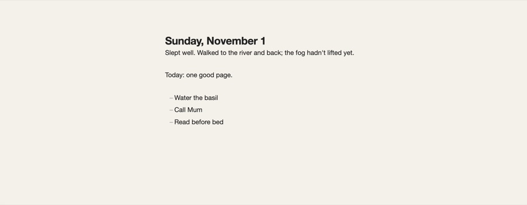<figcaption><b>Daily</b>Today’s note, editable in place.</figcaption></figure>
<figure class="module-card">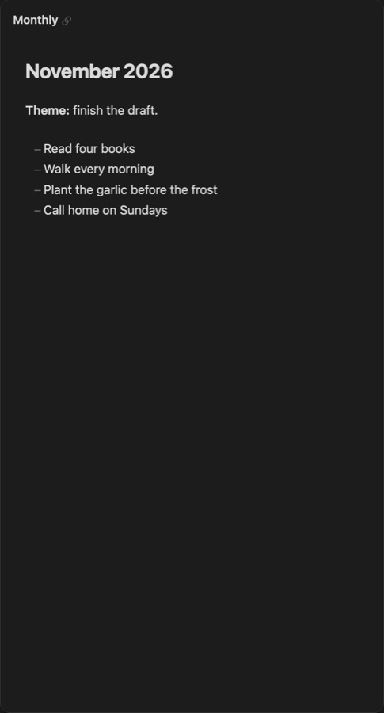<figcaption><b>Monthly</b>The month’s note, following the day.</figcaption></figure>
<figure class="module-card">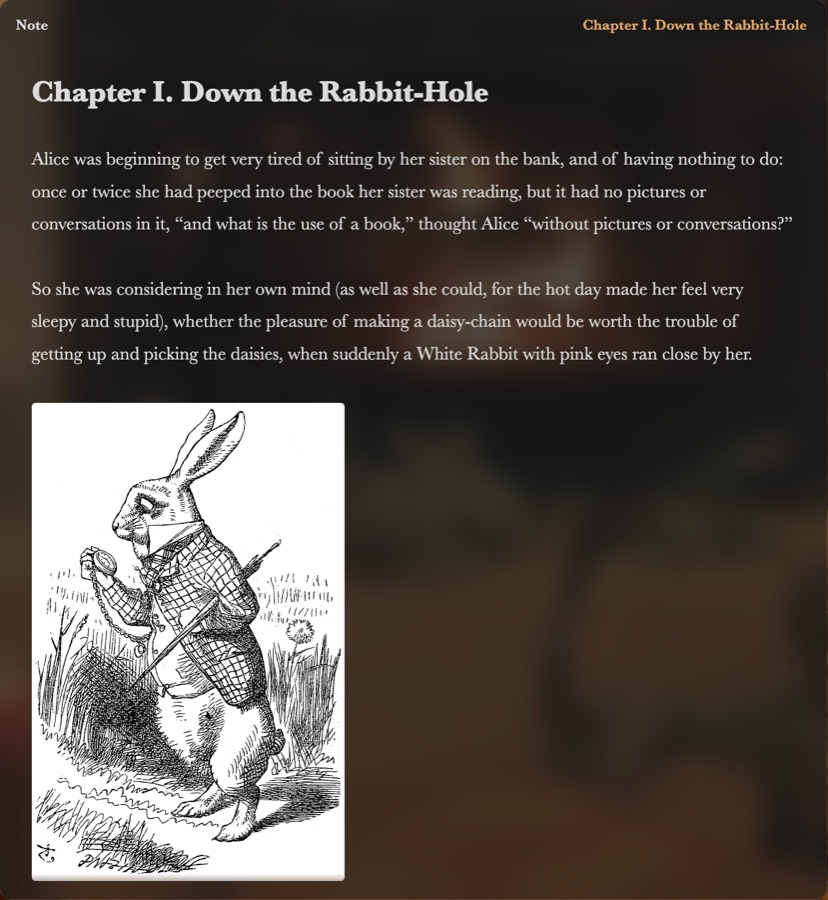<figcaption><b><a href="/note">Note</a></b>Any note, pinned where you want it.</figcaption></figure>
<figure class="module-card">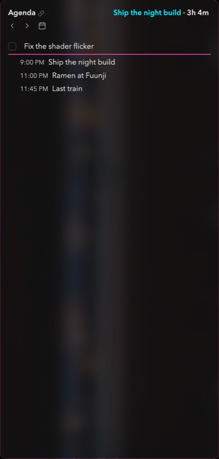<figcaption><b><a href="/agenda">Agenda</a></b>Tasks and events: list, timeline, week, month.</figcaption></figure>
<figure class="module-card">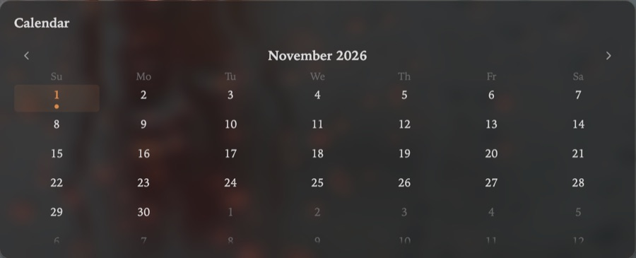<figcaption><b>Calendar</b>The month, a dot where notes are.</figcaption></figure>
<figure class="module-card">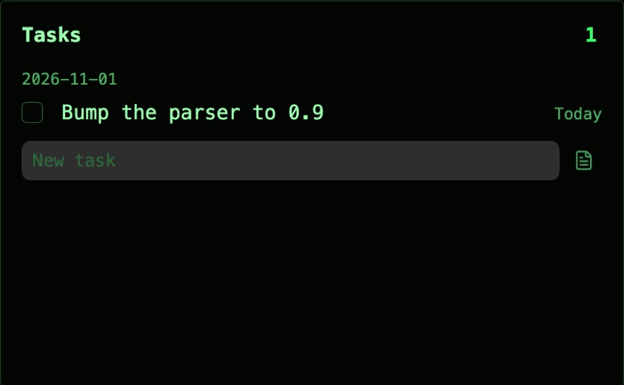<figcaption><b>Tasks</b>What’s due, overdue first.</figcaption></figure>
<figure class="module-card">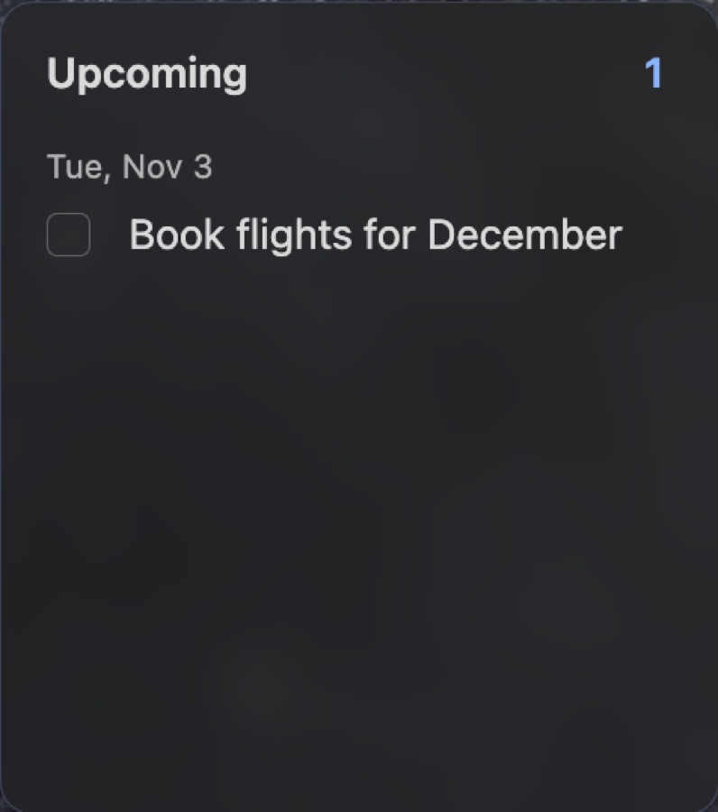<figcaption><b>Upcoming</b>What’s coming next.</figcaption></figure>
<figure class="module-card">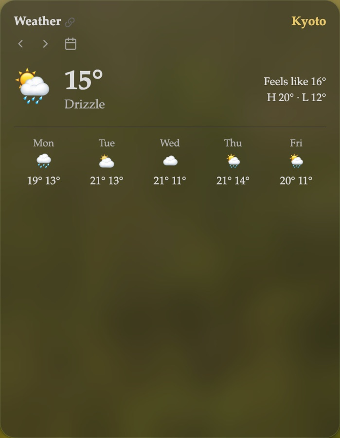<figcaption><b>Weather</b>Now, today and the days ahead.</figcaption></figure>
<figure class="module-card">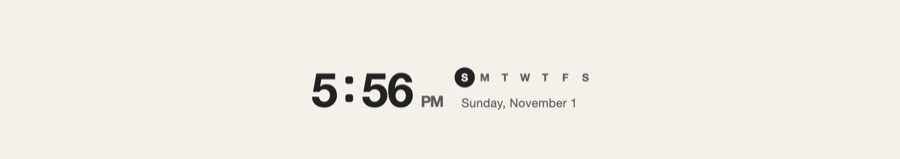<figcaption><b>Clock</b>The time, at any size.</figcaption></figure>
<figure class="module-card">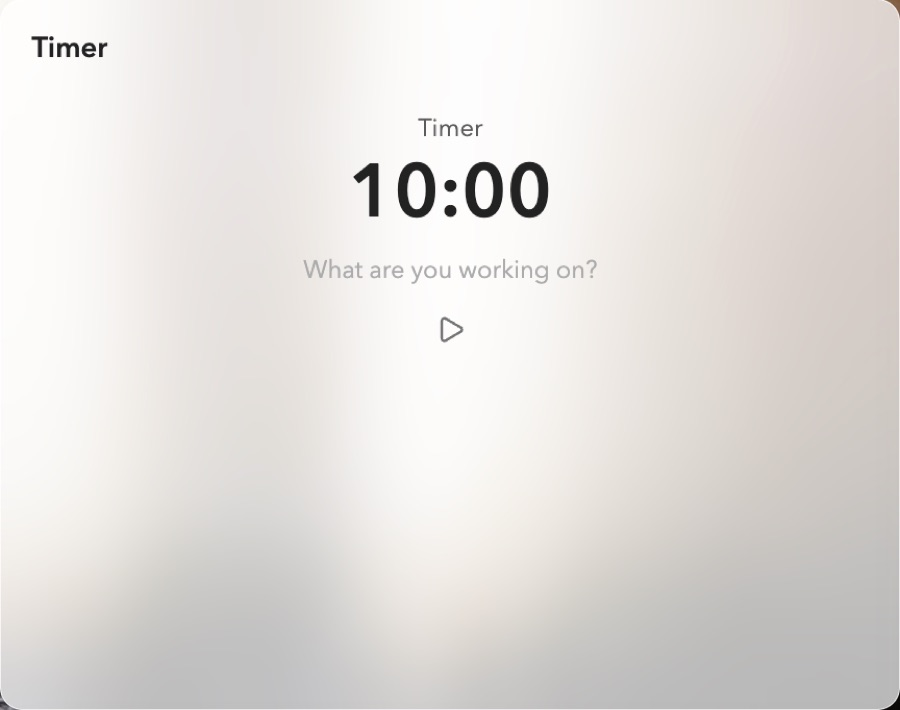<figcaption><b>Pomodoro</b>Focus, breaks, countdowns.</figcaption></figure>
<figure class="module-card">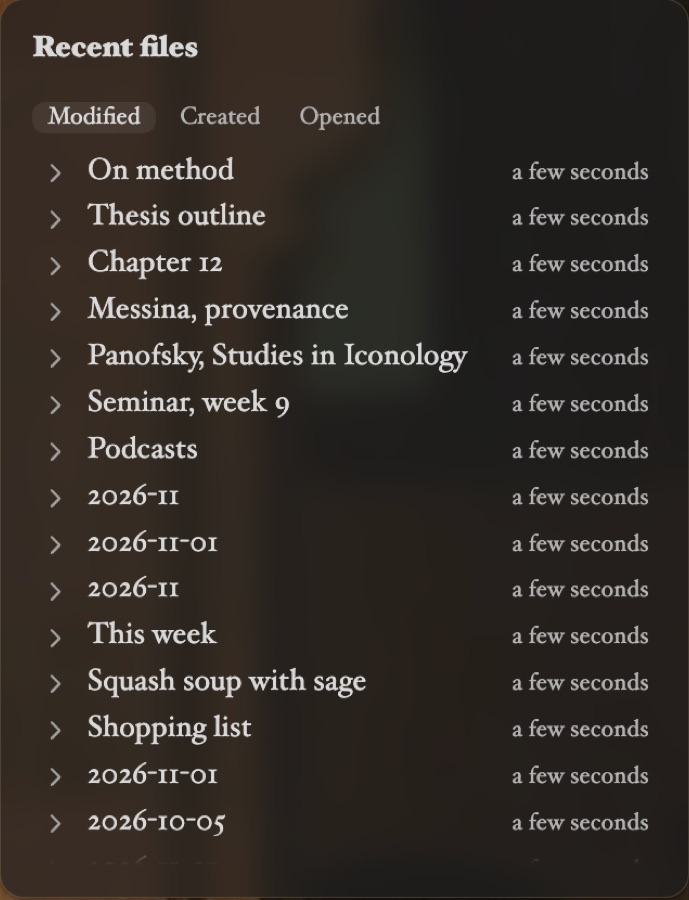<figcaption><b>Recent files</b>What you touched last.</figcaption></figure>
<figure class="module-card pro">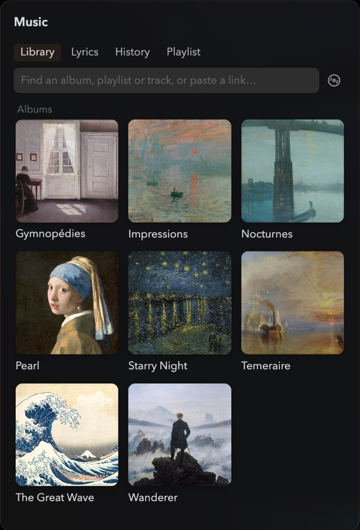<figcaption><b><a href="/music">Music</a></b>Your library, lyrics and playlists.</figcaption></figure>
<figure class="module-card pro">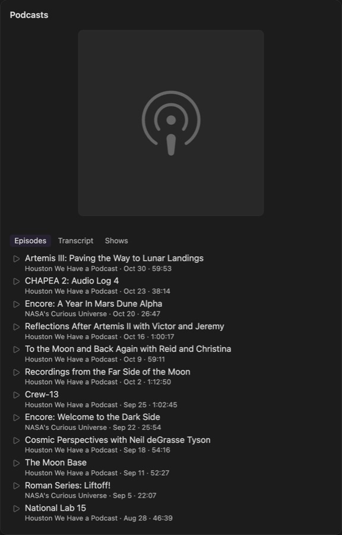<figcaption><b><a href="/podcasts">Podcasts</a></b>Shows and episodes, where you left off.</figcaption></figure>
<figure class="module-card pro">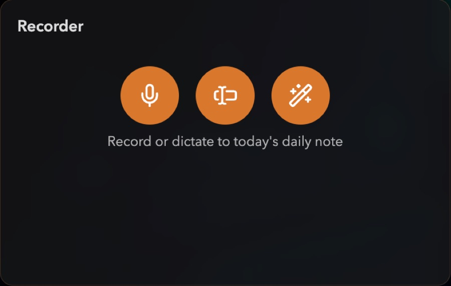<figcaption><b><a href="/recorder">Recorder</a></b>Record, dictate, speak a command.</figcaption></figure>
<figure class="module-card pro">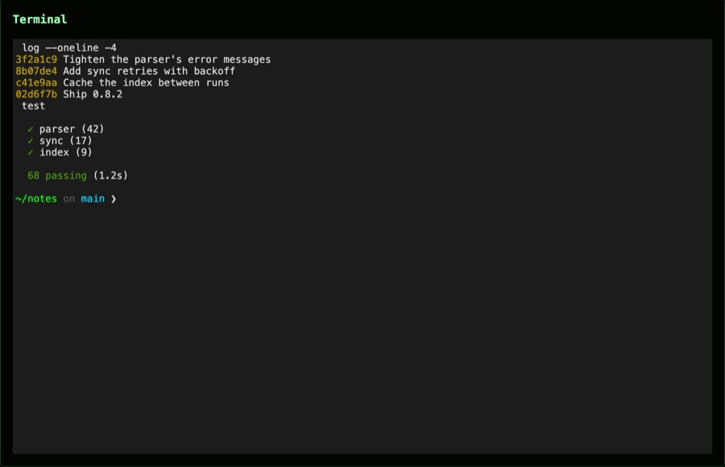<figcaption><b><a href="/terminal">Terminal</a></b>A real shell, in a card.</figcaption></figure>
<figure class="module-card pro">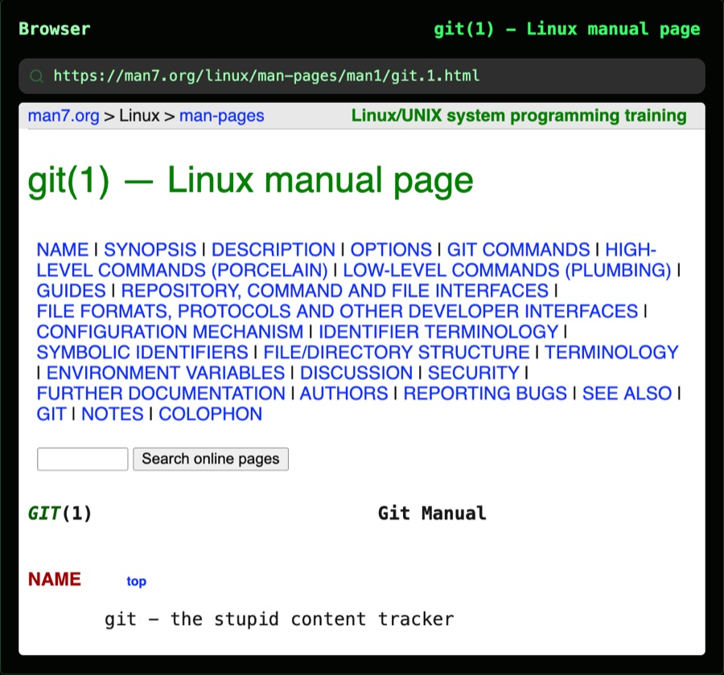<figcaption><b><a href="/web-page">Web page</a></b>The web, or a web app, one card over.</figcaption></figure>
<figure class="module-card pro">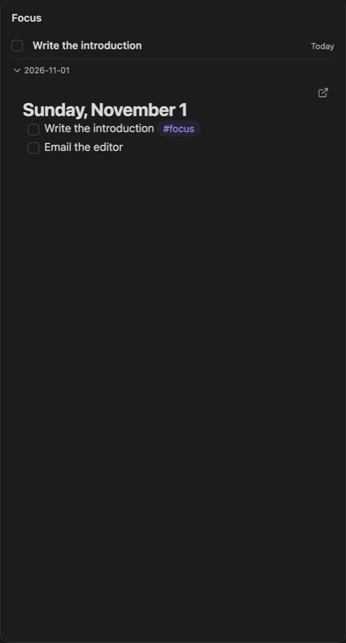<figcaption><b>Focus</b>The task you’re on, and nothing else.</figcaption></figure>
<figure class="module-card pro">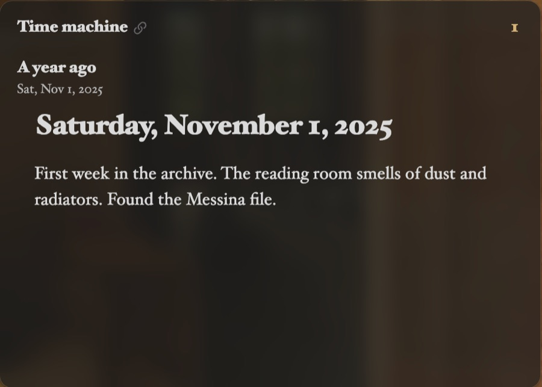<figcaption><b>Time machine</b>What you wrote a year ago today.</figcaption></figure>
<figure class="module-card pro">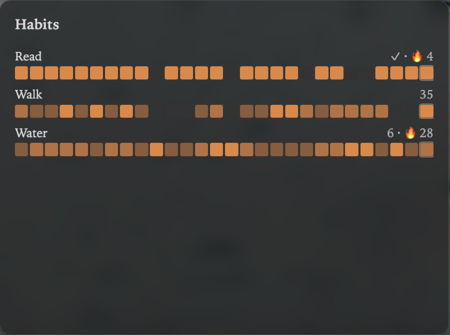<figcaption><b>Habits</b>Little streaks, kept in your notes.</figcaption></figure>

Cards marked with a dot are part of [Atrium Complete](/atrium-complete).
