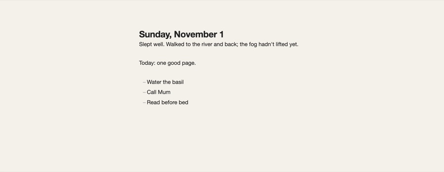

Title: Daily

# Daily | Today's note, *editable in place.*

The Daily card holds the daily note for the day Atrium shows, ready to type in. Its title carries the day, and its arrows move Atrium a day at a time, every card that follows the day with it.

## The day | Back, forward, *today.*

With the card picked out, <kbd>[</kbd> and <kbd>]</kbd> show the day before and after, and <kbd>t</kbd> comes back to today. A day without a note shows **Create daily note**, which makes it from your daily template.

## Weather | The forecast, *beside the date.*

**Show weather**, on the card's right-click menu and in its settings, puts the day's forecast beside the date. Its location and units sit in the card's settings while it shows.

## Settings | How it *shows.*

- **View mode**: live preview, source mode or reading view, for this card only. Default follows Obsidian's.
- **Properties**: **Smart show** keeps them tucked above the note's first line; scroll up past the top, or use the small handle there, to open them. Or always visible, or hidden.
- **Where daily notes live**: the folder, format and template, or the plugin that sets them. With **Daily notes per workspace**, each workspace keeps its own folder.
