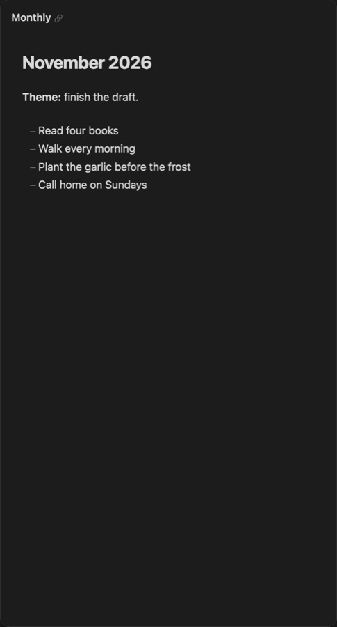

Title: Monthly

# Monthly | The month's note, *following the day.*

The Monthly card edits the note for the month the daily note is in: your goals, a habit grid, the month's log. As the day moves into a new month, the card moves with it.

## Follow the daily note | Or *stay put.*

**Follow the daily note**, on the card's right-click menu and in its settings, is on to begin with. Turned off, the card stays on the month it shows now, whatever day Atrium moves to.

## Settings | How it *shows.*

The card's settings hold its **View mode** and **Properties**, as on the [Daily](/daily) card, and where monthly notes live: their folder, format and template.
