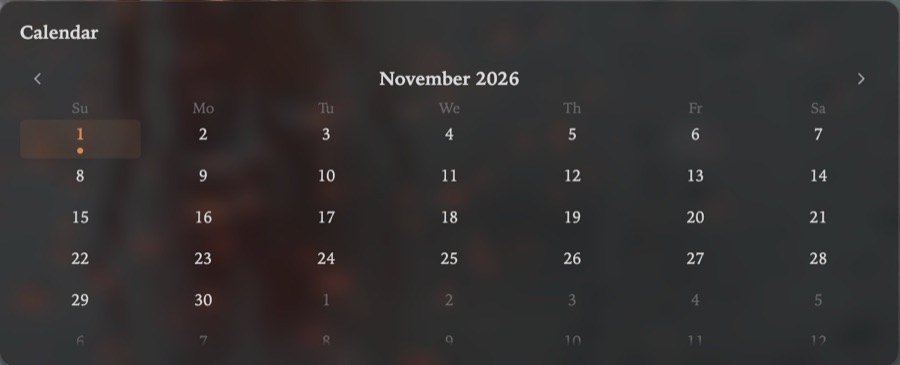

Title: Calendar

# Calendar | The month, *at a glance.*

The Calendar card shows the month around the day Atrium shows, today ringed, with a dot on each day that has a daily note.

## Days | One click *to the note.*

Click a day to open its daily note, expanded over the card; a day without one gets it, made from your daily template. The arrows at the top move a month at a time, without moving the rest of Atrium.

Folded, the card keeps the month beside its title.
