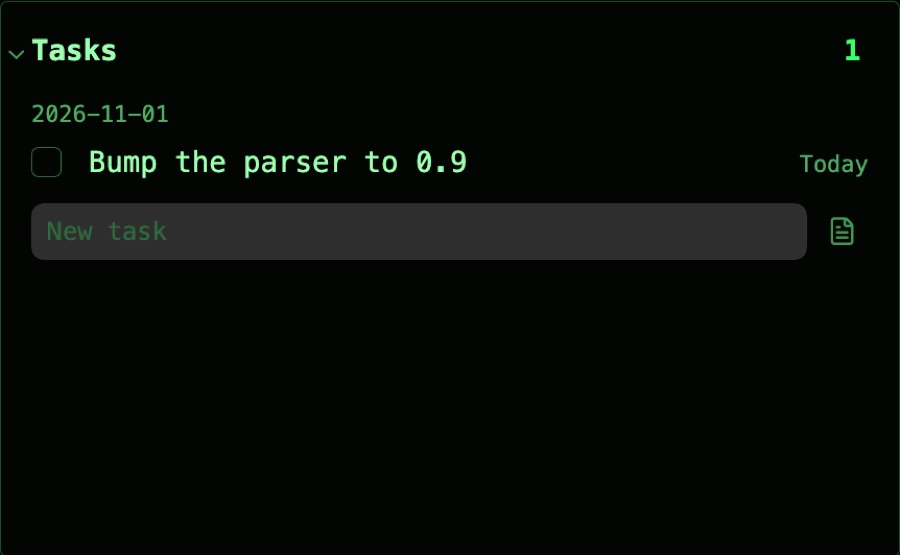

Title: Tasks

# Tasks | What's due, *overdue first.*

The Tasks card lists every open task due today or before, from anywhere in your vault, grouped by the note it's in, oldest first. Tasks marked in progress (`[/]`) also gather at the top, on a tinted panel.

## Working a task | From *the keys.*

<kbd>Enter</kbd> goes to the first task in sight, and the arrows from task to task. On a task:

- <kbd>x</kbd> marks it done or open again, and <kbd>e</kbd> renames it.
- <kbd>r</kbd> defers it: <kbd>m</kbd> tomorrow, <kbd>w</kbd> next week, <kbd>n</kbd> next month, <kbd>d</kbd> a date.
- <kbd>f</kbd> focuses it, which times it from now, for the [Focus](/focus) card, and <kbd>a</kbd> moves it to today's agenda.
- <kbd>n</kbd> turns it into a note of its own, and <kbd>o</kbd> adds a task below it.
- <kbd>Enter</kbd> or <kbd>Space</kbd> expands it, <kbd>Delete</kbd> deletes it, and <kbd>m</kbd> or <kbd>?</kbd> shows its menu.

Ticking a task's checkbox into in progress focuses it, as on the agenda; done, cancelled or back to open stops the clock and leaves it in focus.

## Sections | Fold *what can wait.*

Click a note's heading to fold its tasks away; a folded heading shows how many it holds, and stays folded until you click it again. Its ⋯ holds **Open note** and **Exclude this note**, which hides that note's tasks from the card. Opening the card's filter unfolds every section, so a search sees every task.

## New tasks | Type, *then Enter.*

<kbd>n</kbd>, or **New task** on the card's menu, puts the cursor in the field at the top. End with a day, "call Sam due friday", and the task is due then: today, tomorrow, a weekday, next week or month, "in 3 days", or a date like oct 12. **New tasks as notes** makes each one a note of its own.

## Date range | Any *stretch of days.*

**Date range**, the calendar button in the card's header, lists the tasks due between two dates instead, either end left open. Click it again to come back to what's due.

## Settings | What it *counts.*

- **Undated tasks**: also lists tasks with no date. In a daily or monthly note, one is due on the note's date; elsewhere, it counts from the day it was added.
- **Exclude folders and notes**: the notes and folders whose tasks the card skips.
- **Show count**: how many tasks are listed, at the right of the title.
