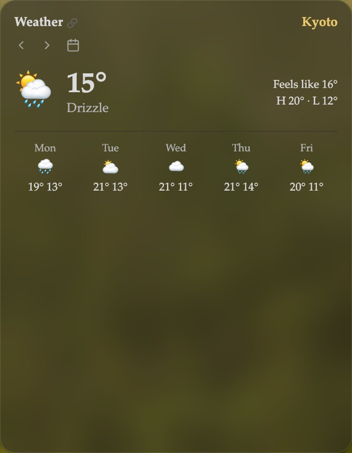

Title: Weather

# Weather | Now, today *and the days ahead.*

The Weather card shows the forecast for the day Atrium shows: on today, the temperature now and what it feels like, with the day's high, low and chance of rain. As the card grows, the next five days join it, then the hours ahead.

Folded, the reading stays beside the title. Tiny, the card shows the reading alone.

## Location | *Anywhere.*

Set a city, or coordinates as latitude, longitude, in the card's settings, and pick Celsius or Fahrenheit. **Save to daily notes automatically** adds the day's weather and temperature to its daily note when you view it, if the note has none yet; today and past days only.

Forecasts come from [Open-Meteo](https://open-meteo.com), free and with no account. See [Network use](/network-use).

## In the daily note's card | *Beside the date.*

**Show weather**, on the [Daily](/daily) card, puts the forecast beside the date there, without a card of its own.
