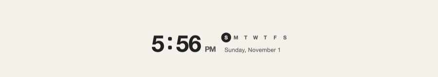

Title: Clock

# Clock | The time, *at any size.*

The Clock card shows the time in large digits, its colon pulsing each second, with the week's days, today ringed, and the date. Everything fits the card as you resize it: under the time when the card is narrow, beside it when wide.

## Settings | *Your* time.

- **24-hour time**: off shows 12-hour time. It starts out the way your system writes times.
- **Seconds**: shows the seconds after the minutes.
