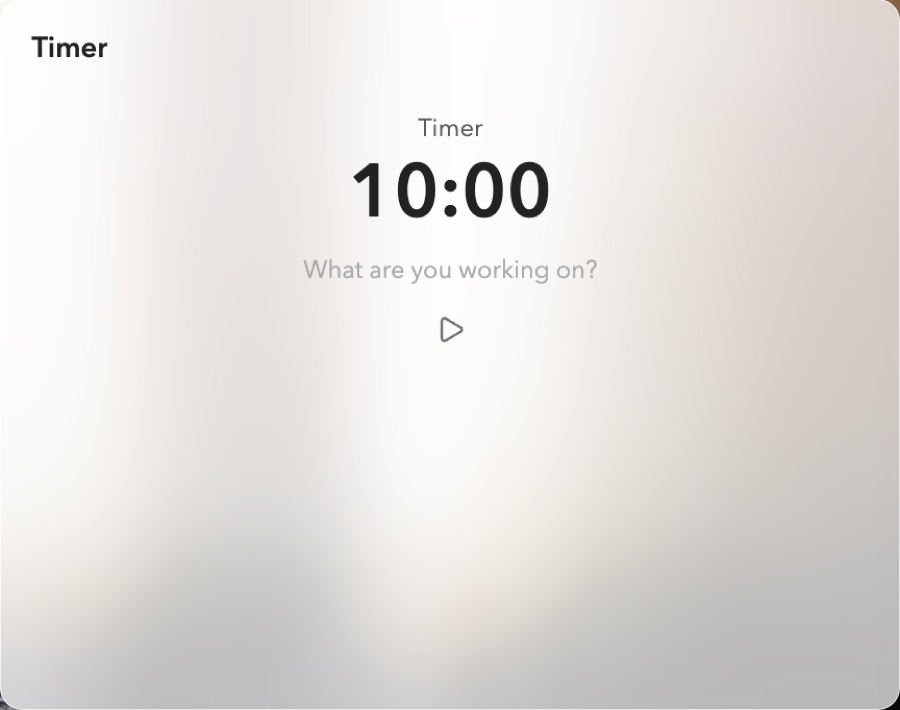

Title: Pomodoro

# Pomodoro | Focus, breaks, *countdowns.*

The Pomodoro card times a cycle of focus sessions and breaks, a countdown, or a stopwatch. Pick the mode from the card's right-click menu: **Pomodoro**, **Timer** or **Stopwatch**.

## Sessions | Logged *in the daily note.*

Type what you're working on and press play. Starting adds a line to today's daily note, `- [10:00 AM] 🍅 Writing #focus`, so the agenda's timeline shows it running; when it ends, the line gets its end, `- [10:00 AM - 10:25 AM] 🍅 Writing`. Left empty, a focus session is for the task you've [focused](/focus), and that task goes in progress. Breaks and timers are logged too, tagged `#tracking` while they run.

Play pauses and resumes, and the card's menu also holds **Stop** and **Skip to next**. The dots under the time count the focus sessions in the round.

There is one Pomodoro: every Pomodoro card and the Focus card's title bar show the same session, so you can start it in one place and stop it in another. Starting it stops anything else being timed.

## Time's up | *What's next?*

When a focus session's time is up, it keeps counting as overtime, with a chime, and asks: **Break**, **Keep going** or **Stop**. After a break: **Back to focus** or **Stop**. A countdown simply ends.

## Settings | *Your* rhythm.

**Focus** 25 minutes, **Short break** 5, **Long break** 15, and **Sessions per round** 4, before the long break. In Timer mode, **Timer** sets the minutes it counts down from.
