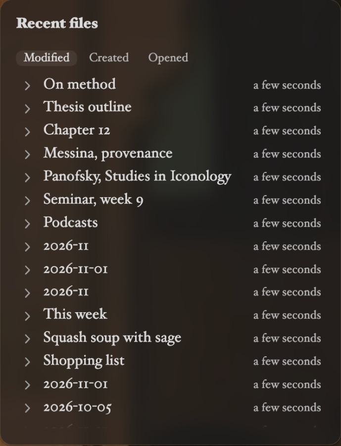

Title: Recent files

# Recent files | What you *touched last.*

The Recent files card lists your vault's files by when they were last **Modified**, **Created** or **Opened**, newest first, with when. The tabs at the top switch between them; the arrow button turns the order to oldest first, across the whole vault.

## Files | Unfurl *or open.*

Click a note to unfurl it below its row, editable in place, and again to fold it. <kbd>⌘</kbd>-click, or any click on another kind of file, opens it in a new tab.

Right-click a file for **Open in new tab**, **Open to the right**, **Open as card**, **Pop out** and **Delete**.
