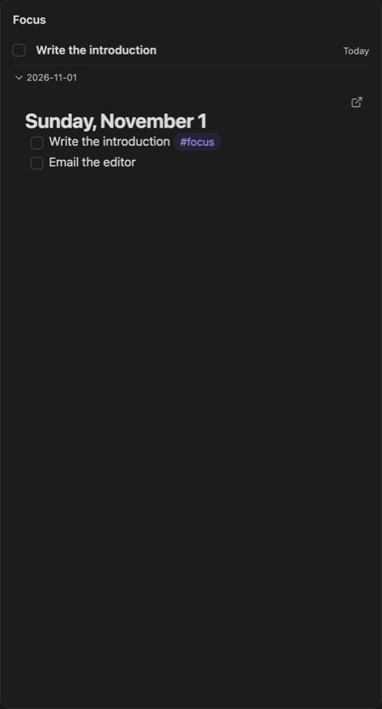

Title: Focus

# Focus | The task you're on, *and nothing else.*

The Focus card answers one question: what am I on right now? It shows the task you've focused, its note to work in, the notes it references, and everything else under way.

## Focusing a task | One *at a time.*

Press <kbd>f</kbd> on a task in the [Tasks](/tasks) card or the agenda, or click its **Focus** button. Focusing times it: the line starts now, `- [/] [10:00 AM] Write report #focus`, and runs on the timeline until it stops. Your focus tag is `#focus` to begin with. Focusing another ends this one. A task note is timed on the line linking to it from today's daily note, added if it isn't there.

**Done and unfocus** (<kbd>d</kbd>), in the card's header, marks it done and ends it. **Unfocus and stop tracking** ends it and takes the tag off; once it has ended, as when it's done or a Pomodoro has the clock, the button just says **Unfocus**. Done on its own ends the time and keeps it on the card until you unfocus it.

Under the task comes its note, editable in place: for an inline task, the section it's in, with a button for the whole note; for a task note, the note itself.

## References | The notes *you need.*

**Add reference** (<kbd>l</kbd>), the field at the card's foot, or its header button, finds a note or makes one and links it under the task, `- [[Meeting notes]]`. The card shows each referenced note under the task, foldable and editable in place; click a note's name to fold it. Right-click one for **Remove reference**, which takes the link out and leaves the note.

## In progress | Everything *under way.*

Below the focused task, **In progress** lists the tasks marked in progress (`[/]`) and whatever is being timed, so nothing running is out of sight.

## Pomodoro | In *the title bar.*

While a task is focused, the [Pomodoro](/pomodoro) sits in the card's title bar. Its focus sessions are for the focused task and logged under its name; a session takes the clock from the task, which stays in focus.

The filter (<kbd>⌘F</kbd>) works across the task's note and its references.
