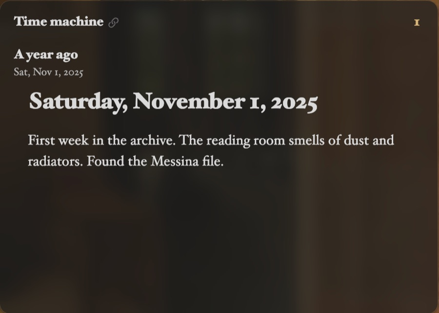

Title: Time machine

# Time machine | What you wrote *a year ago today.*

The Time machine card shows daily notes from before the day Atrium shows, each under how long ago it was and its date. It starts with a year ago, and **On this date**, every earlier year's note for the day.

## Intervals | How *far back.*

In the card's settings, **Add interval** looks back any number of days, weeks, months or years. Each interval shows one note, and a day without a note says so.

The notes open in reading view to begin with, so looking back doesn't change them. The card's filter searches every note it shows at once.
