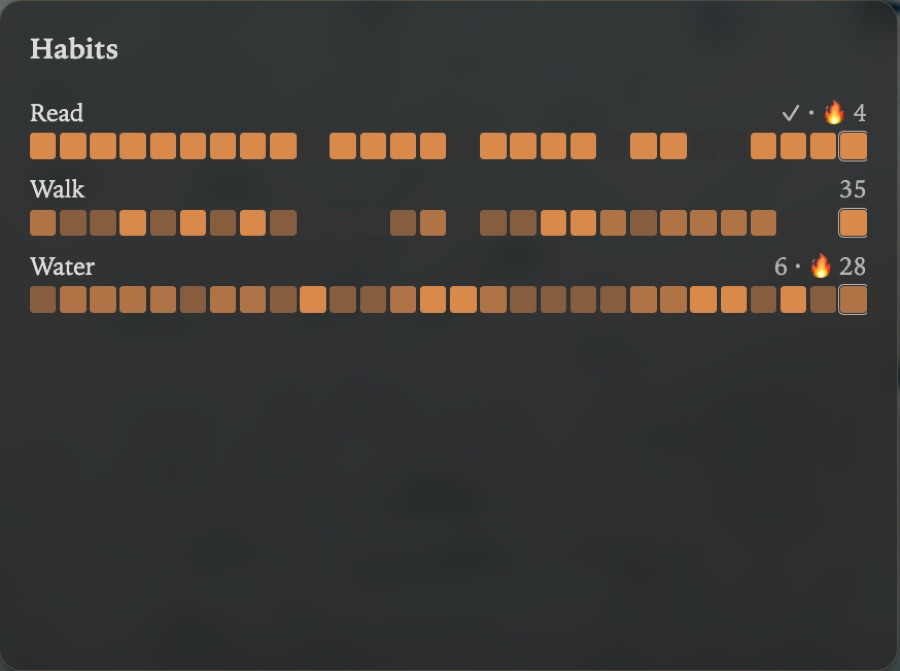

Title: Trends

# Trends | Streaks and measures, *kept in your notes.*

The Trends card draws what you keep in your daily notes: habits over the last few weeks, and measures such as weight or sleep over months. Each key is a number or yes/no in a property, `exercise: 30` or `meditated: true`, or an inline field, `water:: 6`. Each shows its streak, the days in a row it's been done, and the day's value; a day not done yet doesn't break the streak.

## Adding a key | *As your notes write it.*

**Add key**, on the card's right-click menu, asks for the key as your notes write it, such as exercise for `exercise: 30`. The menu also shows or hides each key.

## Views | Days, weeks *or months.*

- **Heatmap**: each key as a row of days, shaded by its value. **Range** sets how many weeks it covers, up to the day shown.
- **Week**: the week's values.
- **Chart**: each number as a line over the last 3, 6 or 12 months, between its lowest and highest values, with its latest value. Days without a value are skipped, and yes/no keys keep their row of days.
