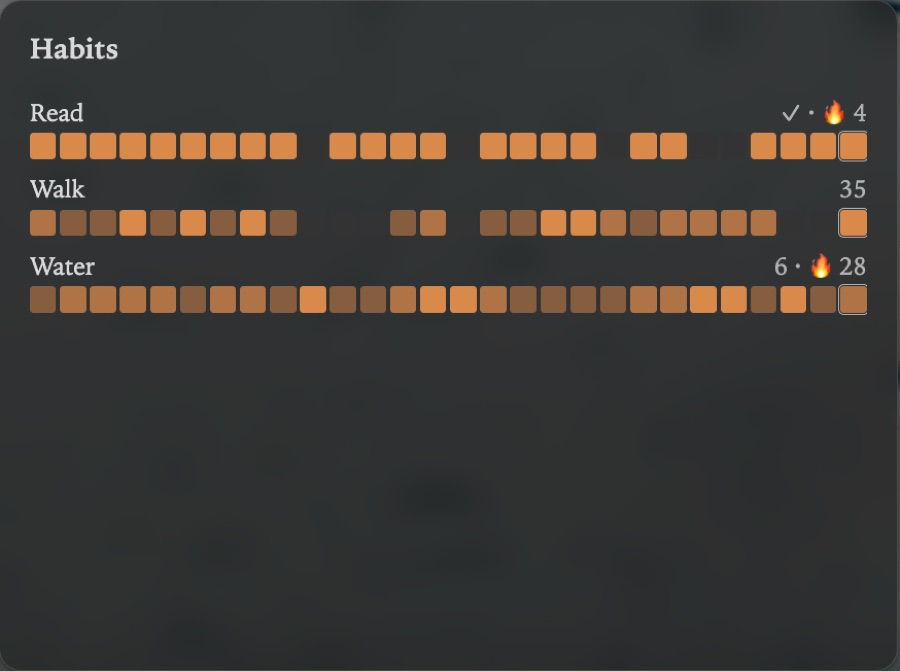

Title: Habits

# Habits | Little streaks, *kept in your notes.*

The Habits card draws the habits you keep in your daily notes over the last few weeks. A habit is a number or yes/no in a property, `exercise: 30` or `meditated: true`, or an inline field, `water:: 6`. Each shows its streak, the days in a row it's been done, and the day's value; a day not done yet doesn't break the streak.

## Adding a habit | *Its key.*

**Add habit**, on the card's right-click menu, asks for the key as your notes write it, such as exercise for `exercise: 30`. The menu also shows or hides each habit.

## Views | Days *or weeks.*

- **Heatmap**: each habit as a row of days, shaded by its value. **Range** sets how many weeks it covers, up to the day shown.
- **Week**: the week's values.
