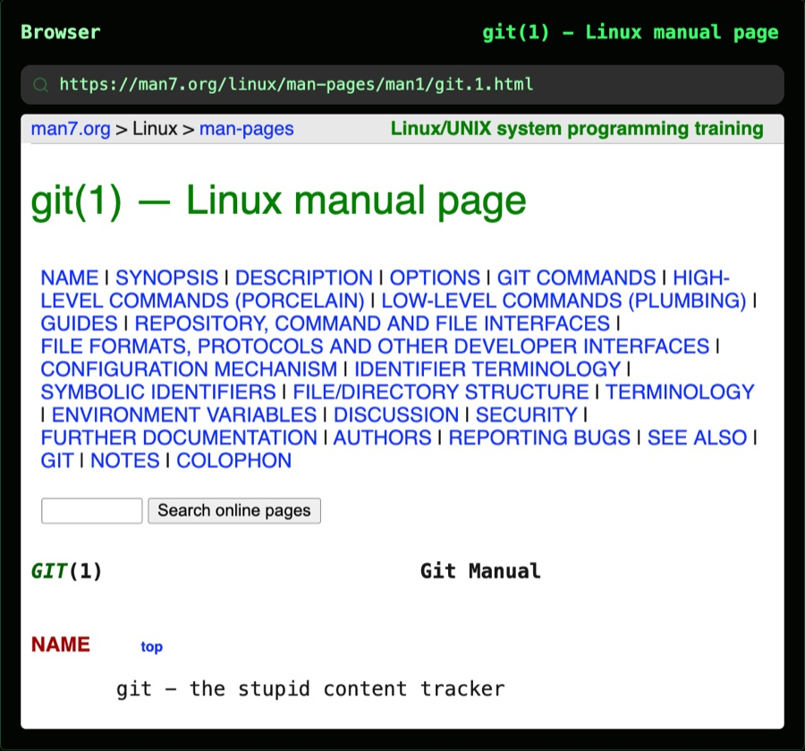

Title: Web page

# Web page | The web, *one card over.*

For quick browsing without leaving Atrium, on desktop.

## Browse | Search, go, *stay put.*

Type in the card's bar to search, with the web viewer's search engine, or to go to an address. Links open in the card instead of a new tab; <kbd>⌘</kbd>-click or middle-click one, or right-click it and choose **Open link in stack**, to open it in a new card stacked with this one. Pasting with the card picked out goes to the address pasted, or searches for the text.

The card starts on the web viewer's home page, or its own, set in the card's settings, and shares the web viewer's session, so sites you're signed in to stay signed in. A card narrower than 600 pixels asks sites for their mobile version. **Search the web** opens Atrium ready to type, or searches for the text selected in a note.

## Web apps | Mail, chat, *as cards.*

Turn off **Address bar** in a card's settings to keep a web app, such as mail or chat, open as a card of its own: the card is titled with the site's name and icon, and an unread count in the page's title, such as "(3)", shows as a badge after its name.

**Separate web sign-ins**, on the workspace's right-click menu, gives the open workspace's web pages their own sign-ins, so work and personal accounts don't mix; **Share web sign-ins** goes back.

## Pages and notes | Each *finds the other.*

- **Add to daily note** adds the text selected on the page to today's daily note, with a link back, or else a link to the page.
- **Note for this page** opens the page's note beside it: one whose `source` or `url` property is the page's address, made if there isn't one. **Save page as note** saves the page's article as a new note.
- A note with a web address as its `source` or `url` gets **Open its page**.
- **Copy page link as Markdown** copies the page as a Markdown link; **Copy link as Markdown**, on a link's right-click menu, copies that link.

Each is a button behind the card's ⋯, a right-click item and a command.
