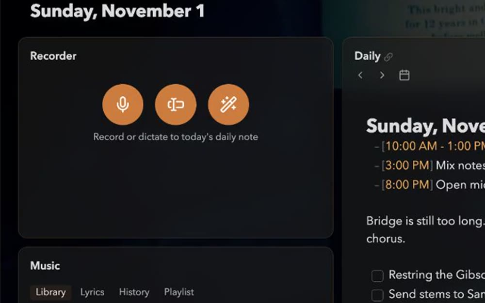

Title: Recorder

# Recorder | Say it. *It's in today's note.*

Three buttons, three ways to get a thought out of your head and into the daily note. Each is also on the card's right-click menu, behind its ⋯ and a command.

## Record | Sound, *saved.*

**Record** (<kbd>r</kbd>) saves the sound as an attachment named like Obsidian's own recordings and adds it to the daily note on a timed line, `- [2:20 PM - 2:22 PM] ![[Recording 20261025142000.webm]]`, so it shows on the agenda too.

While it's under way, a visualizer moves with your voice and the button turns to **Stop and save**; the key that started it stops it too.

## Dictate | Words, *as you speak.*

**Dictate** (<kbd>d</kbd>), on macOS 26 and later, shows what you say in the card as you speak, the words that may still change dimmed. Stopping adds it to the daily note as one timed line, `- [2:20 PM - 2:22 PM] Buy milk and call the dentist at 9.`

It's transcribed on your Mac by Apple's speech recognition, in your system language, and never leaves it. **Keep audio with dictation**, in the card's settings, saves the recording too.

## Speak a command | *Just ask.*

**Speak a command** (<kbd>c</kbd>), on macOS 26 and later, listens until you pause, then tries a few phrases first:

- "open the agenda", "add timer", "show music": picks out that card, unfolding it or bringing it forward in its stack, or adds it.
- "go to tomorrow", "Friday", "next Tuesday", "October 30th": shows that day.
- "switch to Work", "open Home workspace": opens that workspace.

Otherwise it runs the command whose name has every word you said, such as "fold music" or "next workspace", on the card you name or the one picked out. Failing that, "open" and a note's name opens that note. If nothing matches, a command picker opens with your words.

With [Claude Code](https://claude.com/claude-code) installed, **Ask Claude Code**, in the card's settings, sends what no command matches to Claude Code instead, in your Terminal card, so you can follow and answer it.

## History | What you *said.*

**History**, folded under the buttons once you've spoken a command or dictated, lists the latest twenty, newest first. A click runs a command again or opens the note a dictation went to; right-click for **Run again**, **Open note**, **Copy** and **Remove from history**.
